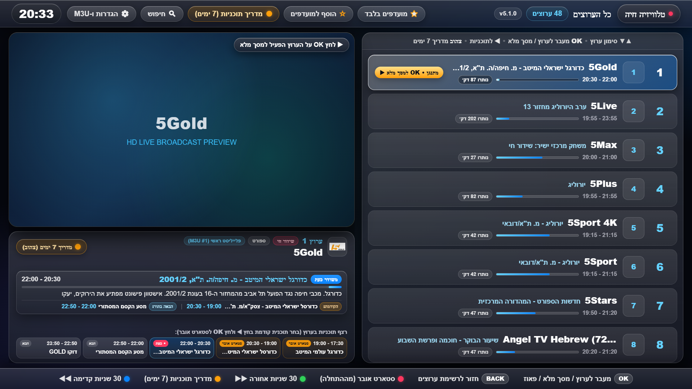
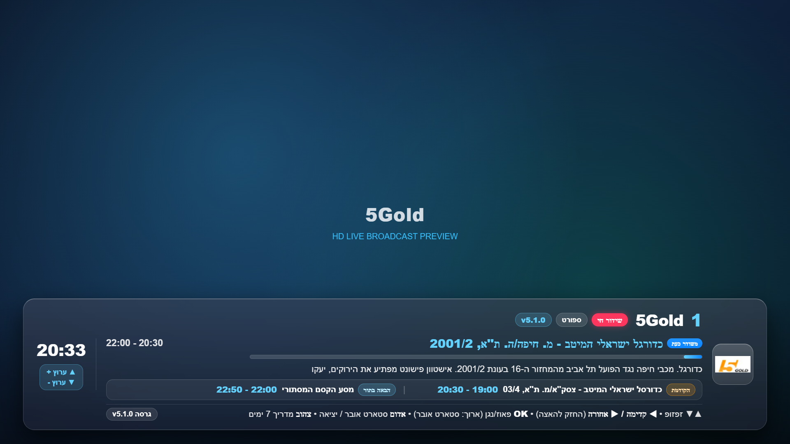

  

<h1 align="center">📺 Live TV for LG webOS (v4.9.8)</h1>

  <strong>Smart, ultra-fast, native-feeling Live TV &amp; Catch-Up IPTV player built specifically for LG webOS Smart TVs (webOS 4.0 – webOS 24+), with an Android One-Click Installer Wizard!</strong>

  <a href="#-english-documentation">English</a> •
  <a href="#-תיעוד-והתקנה-בעברית">עברית (Hebrew)</a> •
  <a href="https://github.com/maorisraelii/iptv-webos/releases/latest">Download Latest Release</a>

  
  
  
  

---

## 📸 Screenshots (v4.9.8)

  
   
  <em>Main Split Workspace: Right-side O(1) Channel List with Real-Time EPG, Mini Progress Bars, Start/End Times &amp; Remaining Minutes + Left-side 16:9 Live Preview &amp; 5-Program Start-Over Strip.</em>

  
   
  <em>Fullscreen Unified Info Bar (OSD): Live &amp; Start-Over programme details, elapsed/total progress, previous &amp; next shows, and instant remote shortcuts.</em>

---

## 🇬🇧 English Documentation

### 🚀 What's New in v4.9.8

1. **Animated Boot Splash &amp; Instant Cold Boot (`index.html`, `appinfo.json`, `js/app.js`)**:
   - Eliminated the gray webOS default splash and blank startup screen by configuring `splashBackground` and an inline `0ms` animated dark splash screen (`#boot-splash`) with `defer` script loading.
   - **Progressive Chunked Channel List**: Renders the first 16 visible rows immediately (`< 10ms`), launches the last-watched channel right away, and renders remaining channels smoothly in `requestAnimationFrame` chunks.
2. **Systemic EPG Fix (`js/epg.js`, `js/app.js`)**:
   - Populates `this.allChannels` **before** calling `loadActiveEPGSources()` so active-playlist channel filtering always runs with the full lineup.
   - Fixed background refresh (`loadEPG`) so fresh network XMLTV replaces stale cached data cleanly without duplicating or mixing old programmes, deduplicates identical start times, and invalidates expired caches where all shows have ended.
3. **Dynamic OTA Changelogs (`ota-release-notes.json`, `scripts/build-ota-manifest.js`)**:
   - OTA update popups now dynamically read `title` and `releaseNotes` from `ota-release-notes.json` for every release instead of showing static text.
4. **Live Start-Over &amp; Unified Info Bar (`v4.9.6`)**:
   - Pressing **Red** 🔴 in fullscreen (or selecting the currently airing show in the guide/strip) restarts the live show from `00:00` (`liveSyncDurationCount: 99999` prevents jumping back to the live edge).
   - Start-Over title, time range, elapsed/total duration (`MM:SS / MM:SS`), and seek/pause updates render directly inside `#fullscreen-osd` without corner badges or toasts.
   - First `▲` / `▼` press while the Info Bar is hidden reveals the Info Bar for the **current channel**; subsequent presses surf channels.

---

### 📱 Option 1 (Easiest): Install via the Android Installer Wizard APK

No PC, no CLI, no IP typing, and no manual file transfers! Install directly from your Android phone on the same Wi-Fi as your LG TV:

1. Download and install the Android Wizard APK on your phone:
   👉 **[Download `IPTV-webOS-Installer.apk`](https://github.com/maorisraelii/iptv-webos/releases/latest/download/IPTV-webOS-Installer.apk)**
2. Open **מתקין IPTV ל-LG** on your phone (make sure phone and TV are on the same Wi-Fi):
   - **Step 1 — Auto-Discover TV**: Tap **"חפש טלוויזיות LG ברשת"** — the app automatically finds your LG TV via SSDP / LAN scan.
   - **Step 2 — Pair &amp; Check Developer Mode**: Tap **"התחבר לטלוויזיה ופתח Developer Mode"** and accept the pairing prompt on the TV with your remote.
     - If **Developer Mode** is not installed yet, the app automatically opens the LG Content Store directly to Developer Mode on your TV so you only click **Install**.
     - If you don't have an LG Developer account yet, tap **"אין לי חשבון LG Developer"** to open the official registration page.
   - **Step 3 — One-Click Install**: On the TV inside Developer Mode, log in with your LG account, turn ON **Dev Mode Status** (TV restarts once), turn ON **Key Server**, enter the 6-character **Passphrase** into the Android app, and tap **"התקן IPTV Live TV לטלוויזיה!"**.
   - The app automatically fetches the TV's SSH key (`port 9991`), downloads the latest `IPTV-Live-webOS.ipk` from GitHub Releases, installs it (`port 9922`), and launches **Live TV** on your TV!

### 💻 Option 2: Install from Windows/Mac/Linux (webOS Dev Manager)

1. Install **Developer Mode** on your LG TV from the LG Apps Store and turn ON **Dev Mode Status** + **Key Server**.
2. Download the latest `.ipk` from GitHub Releases:
   👉 **[Download `com.iptv.livetv_4.9.8_all.ipk` / `IPTV-Live-webOS.ipk`](https://github.com/maorisraelii/iptv-webos/releases/latest)**
3. Open **webOS Dev Manager**, connect to your TV, click **Install App**, and select the downloaded `.ipk`.

---

## 🇮🇱 תיעוד והתקנה בעברית

### מה חדש בגרסה v4.9.8?

1. **עלייה מהירה ומסך פתיחה מונפש (`#boot-splash`)**:
   - ביטול המסך האפור של LG webOS והמסך הריק בעלייה באמצעות `splashBackground`, סגנון מוטמע שמופיע תוך `0ms`, טעינת סקריפטים עם `defer` ואנימציית פתיחה חלקה.
   - **רינדור הדרגתי של רשימת הערוצים**: 16 הערוצים הראשונים עולים מיד (`< 10ms`), הערוץ האחרון שנצפה מתחיל להתנגן מיד, ושאר הערוצים מרונדרים ברקע בלי לתקוע את הממשק.
2. **תיקון יסודי של לוח השידורים (EPG)**:
   - אכלוס רשימת הערוצים (`this.allChannels`) **לפני** טעינת מקורות ה-EPG כדי שסינון הערוצים יעבוד מהשנייה הראשונה.
   - החלפה נקייה של לוח השידורים בעדכון מהרשת (ללא כפילויות וללא ערבוב תוכניות ישנות וחדשות) וזיהוי אוטומטי של Cache שפג תוקפו.
3. **Changelog עדכני בכל עדכון OTA**:
   - רשימת השינויים בחלון ה-OTA נלקחת כעת דינמית מתוך `ota-release-notes.json` עבור כל גרסה חדשה.
4. **סטארט אובר לתוכנית חיה, פס מידע מאוחד ושליטה נוחה (`v4.9.6`)**:
   - לחיצה על הכפתור האדום 🔴 במסך מלא (או בחירת התוכנית המשודרת כעת במדריך) מפעילה **סטארט אובר מהשנייה הראשונה (`00:00`)** גם לתוכנית חיה.
   - פס המידע (`#fullscreen-osd`) מתעדכן בזמן אמת בכל שנייה בפרטי התוכנית המשוחזרת, זמן ניגון נוכחי/כולל והרצות (`◀`/`▶` 15 שניות, ירוק/כחול 30 שניות) ללא הודעות מיותרות בפינה.
   - לחיצה ראשונה על `▲` או `▼` כשפס המידע מוסתר מעלה תחילה את פס המידע של **הערוץ הנוכחי**; רק לחיצה נוספת מדפדפת לערוץ אחר.

---

### 📱 התקנה קלה דרך אשף האנדרואיד מהטלפון (מומלץ!)

בלי מחשב, בלי שורת פקודה ובלי להקליד כתובות IP ידנית:

1. הורד והתקן בטלפון האנדרואיד שלך את אשף ההתקנה:
   👉 **[הורד את האשף לאנדרואיד (`IPTV-webOS-Installer.apk`)](https://github.com/maorisraelii/iptv-webos/releases/latest/download/IPTV-webOS-Installer.apk)**
2. פתח את האפליקציה **"מתקין IPTV ל-LG"** (ודא שהטלפון והטלוויזיה על אותו Wi-Fi):
   - **שלב 1 — איתור אוטומטי**: לחץ על **"חפש טלוויזיות LG ברשת"**. האפליקציה תמצא אוטומטית את הטלוויזיה שלך.
   - **שלב 2 — חיבור ופתיחת Developer Mode**: לחץ על **"התחבר לטלוויזיה ופתח Developer Mode"** ואשר עם השלט את בקשת החיבור על מסך הטלוויזיה.
     - אם אפליקציית **Developer Mode** עדיין לא מותקנת בטלוויזיה, האשף יפתח לך אוטומטית את חנות LG ישר עליה — תצטרך רק ללחוץ **"התקן"**.
     - אם כבר מותקנת, האשף יפתח אותה אוטומטית על המסך.
     - אין לך עדיין חשבון LG Developer? לחץ על הכפתור **"אין לי חשבון LG Developer"** לפתיחת עמוד ההרשמה הרשמי.
   - **שלב 3 — התקנה בלחיצה אחת**:
     1. באפליקציית Developer Mode בטלוויזיה: התחבר לחשבון LG, הדלק **Dev Mode Status** (הטלוויזיה תבצע הפעלה מחדש פעם אחת) ולאחר מכן הדלק את **Key Server**.
     2. הקלד באשף בטלפון את ה-**Passphrase** (6 התווים שמופיעים על מסך הטלוויזיה).
     3. לחץ על **"התקן IPTV Live TV לטלוויזיה!"**.
     - האשף ימשוך אוטומטית את מפתח ה-SSH מהטלוויזיה, יוריד את הגרסה האחרונה מ-GitHub, יתקין אותה לטלוויזיה ויפעיל את האפליקציה מיד!

### 💻 התקנה ממחשב (Windows / Mac / Linux)

1. התקן **Developer Mode** מחנות LG בטלוויזיה, התחבר לחשבון LG, והפעל **Dev Mode Status** + **Key Server**.
2. הורד את קובץ ההתקנה העדכני:
   👉 **[הורד `IPTV-Live-webOS.ipk`](https://github.com/maorisraelii/iptv-webos/releases/latest)**
3. התקן בעזרת **webOS Dev Manager** (לחיצה על **Install App** ובחירת קובץ ה-`.ipk`).

---

### 🎮 שלט הטלוויזיה (Remote Shortcuts)

| כפתור בשלט / Button | מצב רשימה (Browse) | מצב מסך מלא (Fullscreen) |
| :--- | :--- | :--- |
| **▲ / ▼** | דפדוף ברשימת הערוצים | לחיצה 1: פתיחת פס מידע נוכחי • לחיצה 2+: זפזופ |
| **◄ / ►** | מעבר לסטריפ 5 התוכניות / חזור לרשימה | הרצה אחורה / קדימה 15 שניות (בסטארט אובר) |
| **OK** | נגינה / מעבר למסך מלא / הפעלת סטארט אובר | השהיה / המשך (Play/Pause) או אישור זפזופ |
| **0–9** | מעבר מהיר לערוץ עם תצוגת שם הערוץ | מעבר מהיר לערוץ עם תצוגת שם הערוץ |
| **אדום 🔴** | — | **סטארט אובר** לתוכנית המשודרת כעת (מ-`00:00`) |
| **ירוק 🟢 / כחול 🔵** | — | הרצה אחורה / קדימה 30 שניות |
| **צהוב 🟡** | הוספה / הסרה ממועדפים ★ | הוספה / הסרה ממועדפים ★ |
| **Back / Return** | חזרה למסך מלא | חזרה לרשימת הערוצים |
