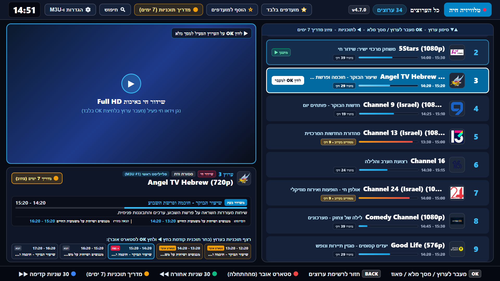

<p align="center">
  
</p>

<h1 align="center">📺 Live TV for LG webOS (v4.7.0)</h1>

<p align="center">
  An ultra-fast, hardware-accelerated, remote-first <strong>IPTV Live TV &amp; Catch-Up Player</strong> engineered specifically for <strong>LG Smart TVs (webOS 4.0 – 24+)</strong>.<br />
  Features <strong>Auto M3U &amp; GZIP XMLTV EPG Extraction</strong>, <strong>Live Channel-Row Mini Progress Bars &amp; Remaining-Time Indicators</strong>, <strong>Progressive Quality Ramp-Up (Smart ABR by Buffer)</strong>, <strong>True 16:9 (960×540 qHD) Live Preview Workspace</strong>, and <strong>Over-The-Air (OTA) Cloud Updates</strong>.
</p>

<p align="center">
  
  <a href="https://github.com/maorisraelii/iptv-webos/actions/workflows/build_ipk.yml"></a>
  
  
  
  <a href="LICENSE"></a>
</p>

---

## 📸 Screenshots (v4.7.0)

<p align="center">
  
  <br />
  <em>Main Split Workspace (v4.7.0): Right-side Wide O(1) Channel List (892px wide) with Live Mini Progress Bars, Start/End Times &amp; Remaining Minutes per Channel + Left-side True 16:9 (960×540) Live Stream Preview, Previous/Current/Next EPG, and 5-Program Start-Over Strip.</em>
</p>

<table>
  <tr>
    <td width="50%" valign="top">
      
      <p align="center"><strong>7-Day Channel Program Guide (Yellow Button)</strong><br />Bounded 7-day catch-up history organized by day tabs (<code>◀ / ▶</code>) with 1-click Start-Over.</p>
    </td>
    <td width="50%" valign="top">
      
      <p align="center"><strong>Zero-Typing QR Code &amp; 4-Digit Cloud M3U Upload</strong><br />Scan the QR code with your phone or enter the 4-digit TV code to beam M3U URLs and <code>.m3u</code> files directly to the TV.</p>
    </td>
  </tr>
  <tr>
    <td colspan="2" valign="top">
      
      <p align="center"><strong>PC Web Studio (<code>manager.html</code>) &amp; Mobile QR Portal (<code>remote.html</code>)</strong><br />Manage multiple M3U sources, upload local <code>.m3u</code> files, toggle channels on/off, assign custom channel numbers, and beam directly to your TV via 4-digit Cloud Code or LAN.</p>
    </td>
  </tr>
</table>

---

## 🚀 What's New in v4.7.0

1. **Automatic M3U EPG Extraction, GZIP `.xml.gz` Decompression &amp; Smart Alias Matching (`js/m3u-parser.js`, `js/epg.js`, `js/lineup-store.js`)**:
   - **Multi-Attribute &amp; Xtream Codes EPG Discovery**: Automatically extracts EPG URLs embedded inside `#EXTM3U` headers (`url-tvg`, `x-tvg-url`, `tvg-url`, `epg-url`, comma-separated multi-URLs) and auto-derives `xmltv.php?username=...&password=...` from Xtream Codes `get.php` or stream URLs.
   - **Persisted Across Cached Cold Boots**: Discovered EPG URLs are persisted inside `CACHED_LINEUP` and loaded automatically on every cold boot.
   - **GZIP `.xml.gz` &amp; Fault-Tolerant XMLTV Scanner**: Automatically detects and decompresses GZIP-compressed `.xml.gz` feeds (`0x1f 0x8b` magic bytes via `DecompressionStream('gzip')`) and uses a fault-tolerant tag scanner so unescaped `&` characters in IPTV XMLTV feeds never break parsing.
   - **Smart Channel Alias &amp; Timezone Matching**: Indexes `<channel id="...">` and all `<display-name>` tags plus Hebrew/English channel synonyms (`כאן 11`/`kan11`, `קשת 12`/`keshet12`, `רשת 13`/`reshet13`, `עכשיו 14`/`now14`, `ספורט 5`/`sport5`), and converts XMLTV timezone offsets (`+0200`/`+0300`/`+0000`) accurately.
2. **Live Mini Progress Bar &amp; Remaining-Time Indicator Inside Every Channel List Row (`js/app.js`, `css/style.css`)**:
   - Every row in the main channel list displays a sleek **Mini Info-Bar** showing:
     - **Start &amp; End Times** (`HH:MM - HH:MM`)
     - **Live Visual Progress Bar (`0% – 100%`)**
     - **Remaining Minutes &amp; "Ending Soon" Alert Badge** (`נותרו X דק׳` or amber/red `מסתיים בקרוב • X דק׳` / `דקה אחרונה!` when a show is `>= 85%` complete) so you know before switching whether a programme just started or is in its final moments.

---

## ✨ Highlights from v4.6.0, v4.4.0 &amp; v4.3.0

- **Progressive Quality Ramp-Up by Buffer (`Smart ABR` in `v4.6.0`)**:
  - Opens every channel at `startLevel: 0` for instant first-frame start and smoothly steps up `autoLevelCapping` (`0 -> mid -> -1 Full HD`) as forward buffer accumulates (`>= 8.5s`), maintaining `1.0x` native clock speed with zero toast spam.

- **True 16:9 (`960×540` qHD) Live Video Preview &amp; Expanded `892px` Channel List (`v4.4.0`)**:
  - Exact `16:9` preview window (`960px × 540px` — half of `1920×1080` Full HD) with zero wasted side pillarbox bars and **73% larger** video picture area, paired with an expanded `892px` channel list column.
- **Zero-Typing QR Code &amp; 4-Digit Cloud M3U Upload (`js/qr-ota.js`, `remote.html`, `manager.html`)**:
  - Scan the inline SVG QR code in **Settings ➔ מקורות שידור (M3U)** with your smartphone or enter the 4-digit TV Pairing Code to beam M3U URLs and local `.m3u` files directly to your TV over HTTPS.
- **Full Over-The-Air (OTA) Cloud Update Engine &amp; Startup Popups (`js/qr-ota.js`, `ota-manifest.json`)**:
  - Automatic OTA check on startup with **"Update Available" (`עדכון גרסה חדש זמין (OTA)`)** and **"Updated Successfully" (`עודכן בהצלחה ✓`)** popups.
- **Version Number Display in Fullscreen Info-Bar &amp; Header (`v4.6.0`)**.

---

## 🎮 Remote Control Mapping

| Remote Button | Action in Main Screen (Browse Mode) | Action in Fullscreen Mode |
| :--- | :--- | :--- |
| **D-Pad Up / Down (`▲ / ▼`)** | Highlight channel &amp; preview EPG (without switching stream) | **Info-Bar Channel Surfing** (preview other channels without interrupting stream) |
| **D-Pad Left (`◀`)** | Move focus to the **5-Show Program Strip** (Past / Live / Next) | Rewind 15 seconds (`◀◀`) |
| **D-Pad Right (`▶`)** | Navigate earlier shows in Program Strip / Return to Channel List | Fast-Forward 15 seconds (`▶▶`) |
| **OK / Center Button** | **1st press**: Switch stream to highlighted channel<br>**2nd press (on active channel)**: Enter Fullscreen<br>**On Program Strip**: Launch Start-Over for selected show | **If Info-Bar hidden**: Show Info-Bar (`#fullscreen-osd`)<br>**If Info-Bar visible**: Toggle **Pause / Play (`❚❚ / ▶`)**<br>**If Surfing**: Confirm &amp; switch to surfed channel |
| **Back (`461` / `ESC`)** | Return focus to Channel List / Enter Fullscreen | Cancel Info-Bar Surfing / Exit Fullscreen to Main Screen |
| **Red Button 🔴 (`403`)** | Start Over current programme (`סטארט אובר`) | Start Over current programme (`סטארט אובר`) |
| **Green Button 🟢 (`404`)** | Rewind 30 seconds (`◀◀`) | Rewind 30 seconds (`◀◀`) |
| **Yellow Button 🟡 (`405`)** | Open **7-Day Channel Program Guide** (`מדריך תוכניות`) | Open **7-Day Channel Program Guide** (`מדריך תוכניות`) |
| **Blue Button 🔵 (`406`)** | Fast-Forward 30 seconds (`▶▶`) | Fast-Forward 30 seconds (`▶▶`) |
| **CH+ / CH−** | Switch immediately to Next / Previous Channel | Switch immediately to Next / Previous Channel |
| **0 – 9 (Digits)** | Direct numeric channel jump (or type custom channel # in Editor) | Direct numeric channel jump |

---

## 📦 Download &amp; Installation

### Method 1: Direct Download via GitHub Releases (Recommended)
1. Download the latest pre-built package from Releases:
   👉 **[Download `com.iptv.livetv_4.7.0_all.ipk` / `IPTV-Live-webOS.ipk`](https://github.com/maorisraelii/iptv-webos/releases/latest)**
2. Open [webOS Dev Manager](https://github.com/webosbrew/dev-manager-desktop) on your PC with your TV connected.
3. Click **Install App** and select `com.iptv.livetv_4.7.0_all.ipk` (or `IPTV-Live-webOS.ipk`).
4. Subsequent updates are delivered automatically via **Over-The-Air (OTA) Cloud Updates** directly inside the app!

### Method 2: 1-Click Local Build &amp; Direct TV Install (PowerShell)
```powershell
# Build .ipk package locally and sync OTA manifest
.\package_ipk.ps1

# Build and install directly to a configured LG TV device
.\package_ipk.ps1 -Device tv
```

---

## 👨‍💻 Author &amp; License

- **Developer**: **Maor Israeli** ([@maorisraelii](https://github.com/maorisraelii))
- **Repository**: [github.com/maorisraelii/iptv-webos](https://github.com/maorisraelii/iptv-webos)
- **License**: Released under the [MIT License](LICENSE).

*Disclaimer: This software is purely a media player client and does not bundle, host, or distribute any IPTV streams or copyrighted content.*
