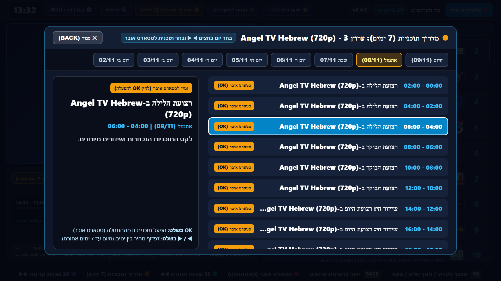
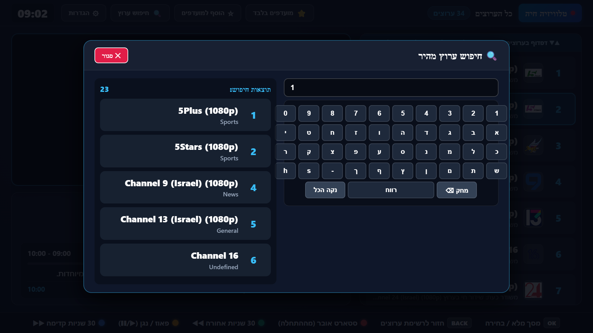

<p align="center">
  
</p>

<h1 align="center">📺 Live TV for LG webOS (v4.4.0)</h1>

<p align="center">
  An ultra-fast, hardware-accelerated, remote-first <strong>IPTV Live TV &amp; Catch-Up Player</strong> engineered specifically for <strong>LG Smart TVs (webOS 4.0 – 24+)</strong>.<br />
  Features a <strong>True 16:9 (960×540 qHD) Live Preview Workspace</strong>, <strong>O(1) 60fps Spatial Navigation Engine</strong>, <strong>&lt; 95ms Instant Cold Boot</strong>, <strong>Zero-Typing QR &amp; 4-Digit Cloud M3U Upload</strong>, <strong>Over-The-Air (OTA) Cloud Updates with Startup Popups</strong>, <strong>Anti-Freeze HLS Buffer Profiles (up to 120s)</strong>, and a <strong>7-Day Program Guide with 1-Click Start-Over</strong>.
</p>

<p align="center">
  
  <a href="https://github.com/maorisraelii/iptv-webos/actions/workflows/build_ipk.yml"></a>
  
  
  
  <a href="LICENSE"></a>
</p>

---

## 📸 Screenshots (v4.4.0)

<p align="center">
  
  <br />
  <em>Main Split Workspace (v4.4.0): Right-side Wide O(1) Channel List (892px wide, OK-only channel switching) + Left-side True 16:9 (960×540) Live Stream Preview (zero wasted side bars), Previous/Current/Next EPG with Start &amp; End times, and 5-Program Interactive Start-Over Strip.</em>
</p>

<table>
  <tr>
    <td width="50%" valign="top">
      
      <p align="center"><strong>7-Day Channel Program Guide (Yellow Button)</strong><br />Bounded 7-day catch-up history organized by day tabs (<code>◀ / ▶</code>) with 1-click Start-Over.</p>
    </td>
    <td width="50%" valign="top">
      
      <p align="center"><strong>Zero-Typing QR Code &amp; 4-Digit Cloud M3U Upload</strong><br />Scan the QR code with your phone or enter the 4-digit TV code to beam M3U URLs and <code>.m3u</code> files directly to the TV.</p>
    </td>
  </tr>
  <tr>
    <td colspan="2" valign="top">
      
      <p align="center"><strong>PC Web Studio (<code>manager.html</code>) &amp; Mobile QR Portal (<code>remote.html</code>)</strong><br />Manage multiple M3U sources, upload local <code>.m3u</code> files, toggle channels on/off, assign custom channel numbers, and beam directly to your TV via 4-digit Cloud Code or LAN.</p>
    </td>
  </tr>
</table>

---

## 🚀 What's New in v4.4.0

1. **True 16:9 (`960×540` qHD) Live Video Preview — Zero Wasted Side Bars (`css/style.css`)**:
   - Engineered the main screen preview window (`.preview-frame-wrapper` & `#preview-frame`) to an **exact 16:9 aspect ratio (`960px × 540px` — exactly half of `1920×1080` Full HD)** with `object-fit: cover`.
   - Eliminates the previous ultra-wide pillarbox bars on the left and right of 16:9 TV broadcasts and increases the actual 16:9 video picture area by **73%**.
2. **Space-Efficient Split Workspace & Expanded Channel List (`892px` Width)**:
   - Expanded the Right-side Channel List Panel (`.channel-list-panel`) from `680px` to **`892px` (`flex: 1`)**, giving every channel row `+212px` more room so full channel titles, current live programme names, and status badges (`מתנגן ▶` / `לחץ OK למעבר`) display cleanly without truncation.
   - Streamlined the EPG Synopsis & 5-Program Start-Over Card (`.channel-details-card`) directly underneath the `960×540` video window for maximum space efficiency.
3. **Live OTA CSS/Layout Patching (`ota-manifest.json`, `js/qr-ota.js`)**:
   - TVs running `v4.3.0` automatically detect `v4.4.0` on launch via the Cloud OTA Engine and apply the new `16:9` layout over-the-air with a single press of **OK**.

---

## ✨ Highlights from v4.3.0 &amp; v4.2.0

- **Zero-Typing QR Code & 4-Digit Cloud M3U Upload (`js/qr-ota.js`, `remote.html`, `manager.html`)**:
  - Scan the inline SVG QR code in **Settings ➔ מקורות שידור (M3U)** with your smartphone or enter the 4-digit TV Pairing Code in `remote.html` / `manager.html` to beam M3U URLs and local `.m3u` files directly to your TV over HTTPS.
  - **Smart Short-Link & Pastebin Code Auto-Expansion (`LineupStore.normalizeM3uInput`)**: Typing an 8-character Pastebin code (e.g., `xYz123Ab`) on the TV automatically expands to `https://pastebin.com/raw/xYz123Ab`.
- **Full Over-The-Air (OTA) Cloud Update Engine & Startup Popups (`js/qr-ota.js`, `ota-manifest.json`)**:
  - Checks the cloud OTA manifest on startup, displays an interactive **"Update Available" (`עדכון גרסה חדש זמין (OTA)`)** modal and a post-update **"Updated Successfully" (`עודכן בהצלחה ✓`)** confirmation modal.
- **Version Number Display in Fullscreen Info-Bar & Header**:
  - Displays `v4.4.0` / `גרסה v4.4.0` inside the Fullscreen Info-Bar (`#fullscreen-osd`), main header (`#header-version-badge`), and Settings ➔ About.
- **OK-Only Channel Switching, Prev/Now/Next Start & End Times, 2-Step Center Button (`OK`) Pause/Play, and Anti-Freeze HLS Buffer (`15s` / `35s` / `65s` / `120s`)**.

---

## 🎮 Remote Control Mapping

| Remote Button | Action in Main Screen (Browse Mode) | Action in Fullscreen Mode |
| :--- | :--- | :--- |
| **D-Pad Up / Down (`▲ / ▼`)** | Highlight channel &amp; preview EPG (without switching stream) | **Info-Bar Channel Surfing** (preview other channels without interrupting stream) |
| **D-Pad Left (`◀`)** | Move focus to the **5-Show Program Strip** (Past / Live / Next) | Rewind 15 seconds (`◀◀`) |
| **D-Pad Right (`▶`)** | Navigate earlier shows in Program Strip / Return to Channel List | Fast-Forward 15 seconds (`▶▶`) |
| **OK / Center Button** | **1st press**: Switch stream to highlighted channel<br>**2nd press (on active channel)**: Enter Fullscreen<br>**On Program Strip**: Launch Start-Over for selected show | **If Info-Bar hidden**: Show Info-Bar (`#fullscreen-osd`)<br>**If Info-Bar visible**: Toggle **Pause / Play (`❚❚ / ▶`)**<br>**If Surfing**: Confirm &amp; switch to surfed channel |
| **Back (`461` / `ESC`)** | Return focus to Channel List / Enter Fullscreen | Cancel Info-Bar Surfing / Exit Fullscreen to Main Screen |
| **Red Button 🔴 (`403`)** | Start Over current programme (`סטארט אובר`) | Start Over current programme (`סטארט אובר`) |
| **Green Button 🟢 (`404`)** | Rewind 30 seconds (`◀◀`) | Rewind 30 seconds (`◀◀`) |
| **Yellow Button 🟡 (`405`)** | Open **7-Day Channel Program Guide** (`מדריך תוכניות`) | Open **7-Day Channel Program Guide** (`מדריך תוכניות`) |
| **Blue Button 🔵 (`406`)** | Fast-Forward 30 seconds (`▶▶`) | Fast-Forward 30 seconds (`▶▶`) |
| **CH+ / CH−** | Switch immediately to Next / Previous Channel | Switch immediately to Next / Previous Channel |
| **0 – 9 (Digits)** | Direct numeric channel jump (or type custom channel # in Editor) | Direct numeric channel jump |

---

## 📱 Easy M3U Upload: Phone QR Scan or PC Web Studio

### Option A: Scan QR Code with Your Smartphone (Fastest — Zero Setup)
1. On your LG TV, click **הגדרות ו-M3U** in the top header.
2. Scan the **QR Code** displayed on screen with your phone's camera.
3. Paste your M3U URL(s) or select an `.m3u` file from your phone and tap **"שלח לטלוויזיה כעת"**.
4. Your TV automatically receives the playlists within 2 seconds!

### Option B: PC Web Studio (`manager.html`) via 4-Digit Cloud Code or LAN
1. Open `manager.html` in your computer browser (or run `npm run studio` for local LAN sync).
2. Add one or more M3U URLs or upload local `.m3u` files, toggle channels on/off, and customize channel numbers.
3. Enter the **4-digit code** shown on your TV and click **"שלח לטלוויזיה בענן (ללא שרת)"**!

---

## 📦 Download &amp; Installation

### Method 1: Direct Download via GitHub Releases (Recommended)
1. Download the latest pre-built package from Releases:
   👉 **[Download `com.iptv.livetv_4.4.0_all.ipk` / `IPTV-Live-webOS.ipk`](https://github.com/maorisraelii/iptv-webos/releases/latest)**
2. Open [webOS Dev Manager](https://github.com/webosbrew/dev-manager-desktop) on your PC with your TV connected.
3. Click **Install App** and select `com.iptv.livetv_4.4.0_all.ipk` (or `IPTV-Live-webOS.ipk`).
4. Subsequent updates are delivered automatically via **Over-The-Air (OTA) Cloud Updates** directly inside the app!

### Method 2: 1-Click Local Build &amp; Direct TV Install (PowerShell)
```powershell
# Build .ipk package locally and sync OTA manifest
.\package_ipk.ps1

# Build and install directly to a configured LG TV device
.\package_ipk.ps1 -Device tv
```

---

## 🛠️ Troubleshooting: Resolving `-5: ipk verified failed`

If webOS Dev Manager or `ares-install` returns `-5: ipk verified failed`:
1. **TV Date &amp; Time Out of Sync (Most Common Cause)**:
   - On your LG TV, go to **Settings ➔ General ➔ Time &amp; Date** and verify the date, time, and timezone are accurate.
2. **Developer Mode Session**:
   - Ensure the **Developer Mode** app on your TV has an active session and Key Server is enabled.

---

## 👨‍💻 Author &amp; License

- **Developer**: **Maor Israeli** ([@maorisraelii](https://github.com/maorisraelii))
- **Repository**: [github.com/maorisraelii/iptv-webos](https://github.com/maorisraelii/iptv-webos)
- **License**: Released under the [MIT License](LICENSE).

*Disclaimer: This software is purely a media player client and does not bundle, host, or distribute any IPTV streams or copyrighted content.*
